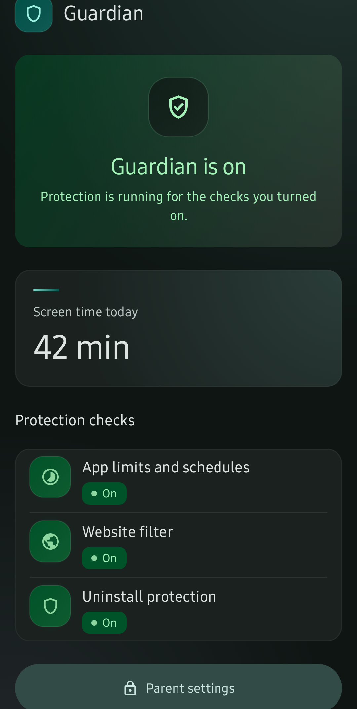
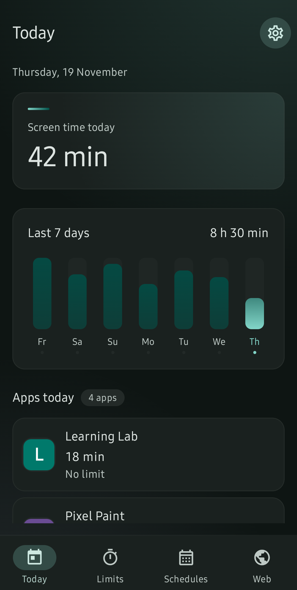
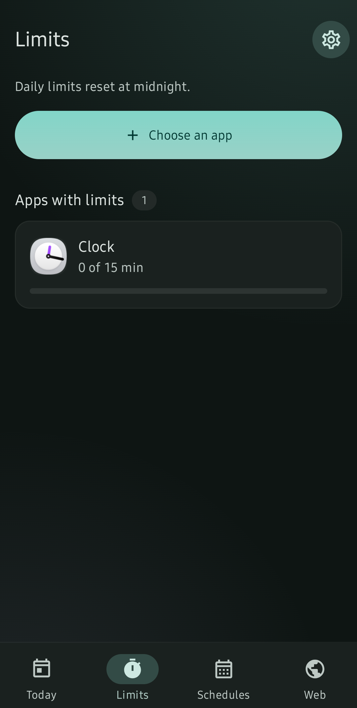
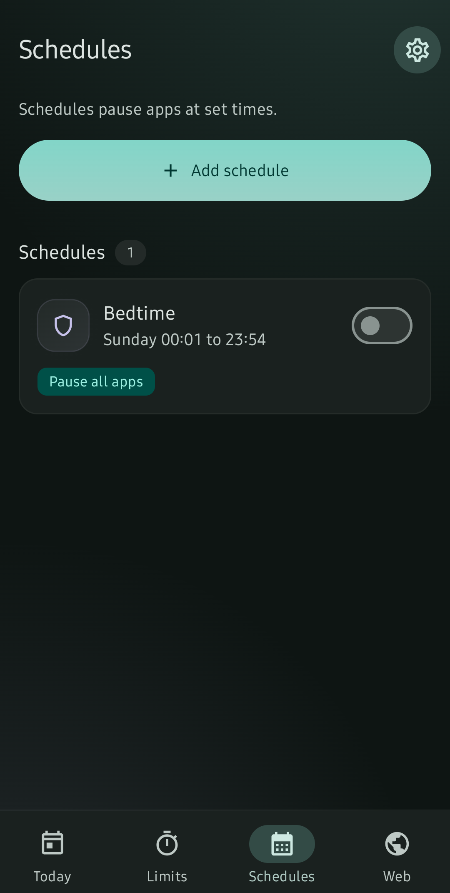
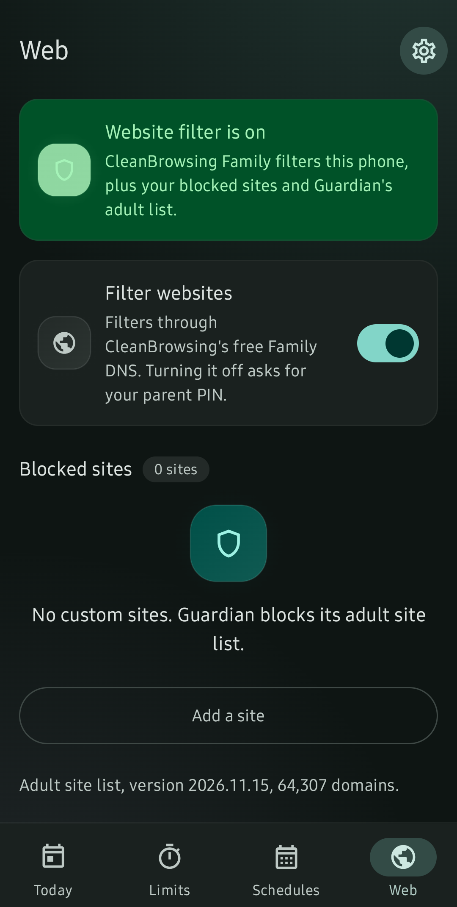
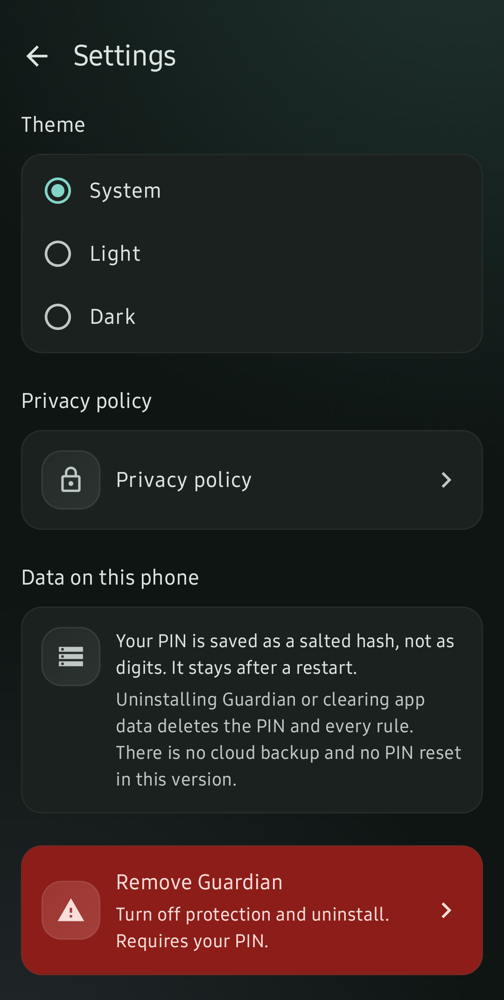

# Guardian

Parental controls for one Android phone, running entirely on that phone.

Guardian sets daily app limits, bedtime and study schedules, and a DNS-based
website filter, then reports screen time to the parent. There is no Guardian
account, no Guardian server, no ads, and no analytics.

**Current release: [v1.0.0](https://github.com/Nor2522/Guardian/releases/tag/v1.0.0)** —
Android 8.0+ (API 26), `com.nordev.guardian`, versionCode 1.

## Screenshots

<table>
  <tr>
    <td align="center"><br><sub>Child: protection status and screen time</sub></td>
    <td align="center"><br><sub>Parent: today, seven-day chart, apps</sub></td>
    <td align="center"><br><sub>Daily app limits</sub></td>
  </tr>
  <tr>
    <td align="center"><br><sub>Bedtime and study schedules</sub></td>
    <td align="center"><br><sub>Website filter and blocked sites</sub></td>
    <td align="center"><br><sub>Parent settings</sub></td>
  </tr>
</table>

The two Today screens were captured with sample data (invented apps and
minutes); the other four come from the same build with the real configuration.
How each image was made is documented in
[`docs/store/graphics/README.md`](docs/store/graphics/README.md).

## Features

- **Daily app limits.** Pick the time per app; when it runs out, Guardian shows a
  pause screen the child cannot dismiss alone. Limits reset at midnight.
- **Schedules.** Block everything except the apps you allow, with windows that can
  cross midnight and overlap.
- **Website filter.** A bundled adult-domain list plus your own blocked sites,
  resolved over DNS over TLS through CleanBrowsing's free Family filter. The
  local VPN carries DNS only — no other traffic is routed or inspected.
- **Screen time.** Today and the last seven days, per app, from Android's usage
  stats.
- **Parent PIN.** Required to change rules, open the parent screens, or remove the
  app. Stored only as a salted PBKDF2 hash.
- **Uninstall protection.** Optional Device Admin makes removal require the PIN.
- **Visible protection.** An ongoing "Guardian is on" notification, and a status
  screen that names any check that is off.

## How it works

Guardian is a single Android app with no backend.

| Piece | Role |
| --- | --- |
| `UsageStatsManager` | Reads foreground time per app for screen time and limits |
| Accessibility service | Notices which app is in the foreground so limits and schedules can act, and gates the system VPN and Device Admin screens behind the PIN. It does not read screen text, capture the screen, or perform gestures |
| `VpnService` | Runs a local, DNS-only tunnel that forwards queries over TLS (port 853) to CleanBrowsing Family; blocked names are answered on the phone |
| `DeviceAdminReceiver` | Makes uninstall require the parent PIN |
| DataStore | Keeps rules, blocked sites, and the PIN hash in app-private storage |

Limits, schedules, and the filter are evaluated on the phone. The only data that
leaves the device is the domain names looked up while the filter is on.

## What it cannot do

- A DNS filter cannot see inside HTTPS. Apps and browsers that use their own
  encrypted DNS, or connect to a hardcoded IP address, can bypass it.
- Android's Quick Settings can turn the VPN off without the app's guard.
- When CleanBrowsing is unreachable, lookups fail rather than resolve unfiltered.
- Guardian does not read messages, photos, passwords, or keystrokes, and does not
  use the camera, microphone, or location.
- No filter is perfect. Guardian does not promise that.

## Install

### From GitHub Releases

1. Download `Guardian-1.0.0.apk` from the
   [latest release](https://github.com/Nor2522/Guardian/releases/latest).
2. Open it on the phone and allow your browser or file manager to install unknown
   apps when Android asks. This can be switched back off afterwards.
3. Play Protect may warn that the app did not come from Google Play. Verify the
   fingerprint below, then install anyway.
4. Open Guardian, set a parent PIN, and grant the checks you want: Usage access,
   Accessibility, the local VPN, notifications, and Device Admin for uninstall
   protection. Each one is explained in the app before the system screen opens.

The APK is signed with the release key. It updates in place over any build signed
with the same key and keeps the PIN, rules, and usage data; a build signed with a
different key cannot be installed over it.

```
SHA-256  4477d391d299d4d36e1c1ef1385e0f35beb61f69f943bd62da0d5b8c9749f559
Signer   CN=Guardian, O=NorDev, C=SO
Cert     BB:8E:AA:B0:27:F9:29:FA:B4:1B:B1:86:B0:4D:29:58:07:62:8D:CE:4E:E4:B6:50:75:1C:8C:F5:D9:77:A2:69
```

The `.aab` attached to the release is the same bundle prepared for Google Play. It
is an archival asset and cannot be installed by hand.

### Google Play

Not published yet. The signed bundle is ready for the internal testing track; the
listing, declarations, and Data safety answers live in
[`docs/store/`](docs/store/).

## Build

Requirements: JDK 17, Android SDK with platform 36 or 37. The project builds with
the bundled Gradle wrapper.

```bash
./gradlew assembleDebug          # debug APK
./gradlew testDebugUnitTest      # unit tests
./gradlew lintDebug              # Android lint
./gradlew assembleRelease        # signed APK (needs the upload key)
./gradlew bundleRelease          # signed AAB for Google Play
```

Release signing is optional for local work. If a `keystore.properties` file exists
at the project root, the release build signs with it; otherwise the release build
is left unsigned and everything else still runs:

```properties
storeFile=/path/to/upload.jks
storePassword=...
keyAlias=...
keyPassword=...
```

`keystore.properties`, `*.jks`, and `*.keystore` are gitignored. No key material is
stored in this repository.

## Project layout

```
app/src/main/java/com/nordev/guardian/
  data/      usage stats, preferences, permission checks, web filter storage
  domain/    limits, schedules, PIN hashing, domain matching, blocked-site policy
  service/   accessibility service, DNS VPN service, boot receiver, device admin
  ui/        Compose screens, navigation, theme, shared components
app/src/main/assets/adult-domains.txt   bundled adult-domain list
docs/        design, plan, VPN and uninstall design, store material
```

UI is Kotlin with Jetpack Compose and Material 3. The app targets Android 8.0
through Android 16 and supports light and dark themes, 200 % font scaling, and
TalkBack.

## Tests and docs

- 90 unit tests (`./gradlew testDebugUnitTest`) cover schedule windows, domain
  matching, PIN hashing, policy coding, DNS packet handling, and usage summaries.
- [`docs/design.md`](docs/design.md) — visual and interaction contract
- [`docs/vpn-design.md`](docs/vpn-design.md) — DNS filter design
- [`docs/uninstall-design.md`](docs/uninstall-design.md) — uninstall protection
- [`docs/plan.md`](docs/plan.md) — build plan and known limits
- [`docs/third-party.md`](docs/third-party.md) — adult list source and license

## Privacy

Guardian keeps usage, rules, and the PIN on the phone. While the filter is on, the
domain names the phone looks up are sent over encrypted DNS to CleanBrowsing's
Family filter; nothing is sent to the developer. Uninstalling the app or clearing
its data deletes everything, because there is no account and no server copy.

Full policy: <https://nor2522.github.io/Guardian/site/>

## Who this is for

Guardian is a monitoring app for parents, installed on a child's phone. It shows
a persistent notification while protection runs and does not hide itself. It is
not for monitoring another adult.

## Third-party material

The adult-domain list is derived from
[StevenBlack/hosts](https://github.com/StevenBlack/hosts) (porn-only alternate,
snapshot 2026-11-15, 64,307 domains after normalization). DNS filtering uses
[CleanBrowsing](https://cleanbrowsing.org/) Family DNS. Details and licenses:
[`docs/third-party.md`](docs/third-party.md).
